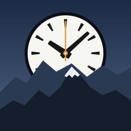
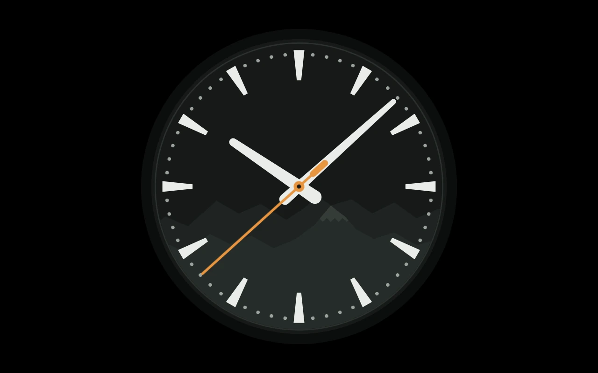
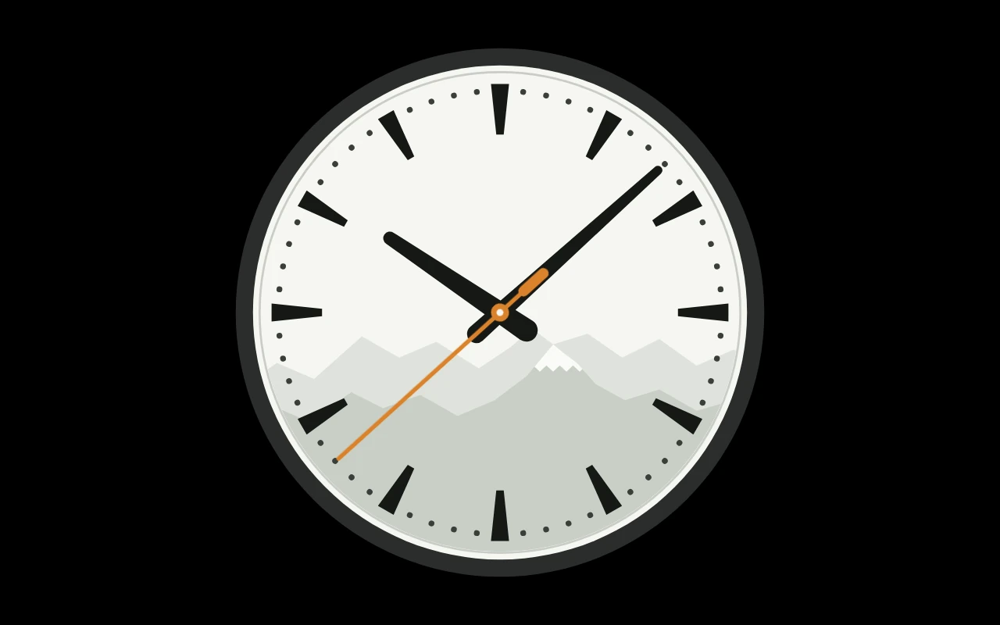
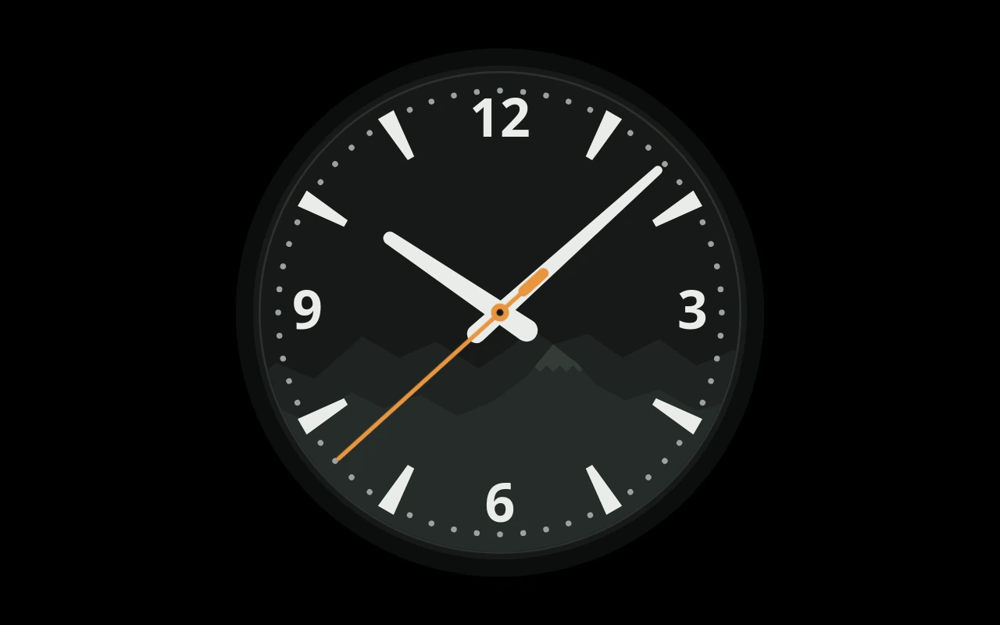
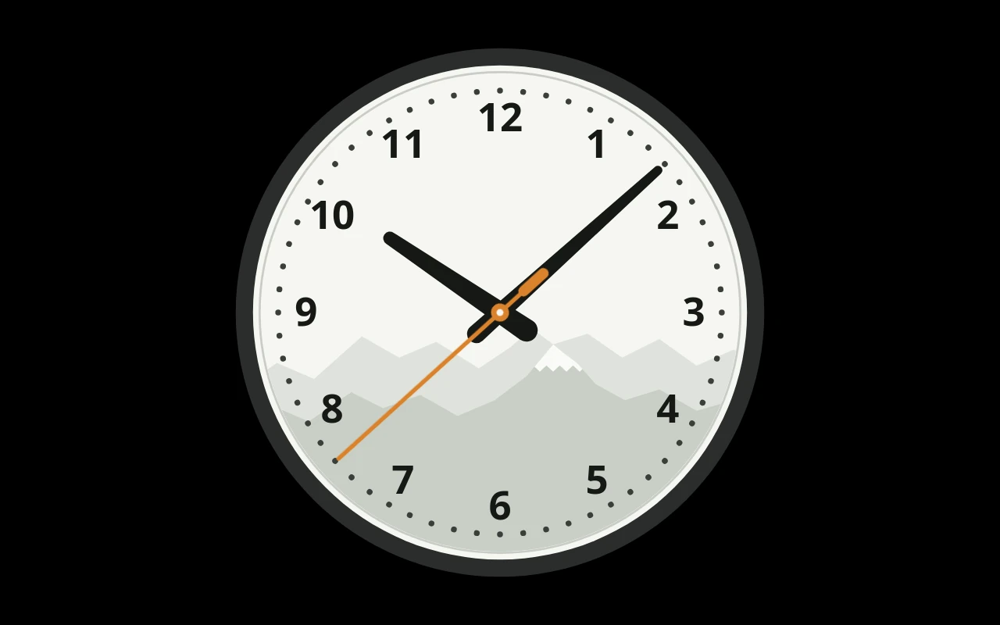
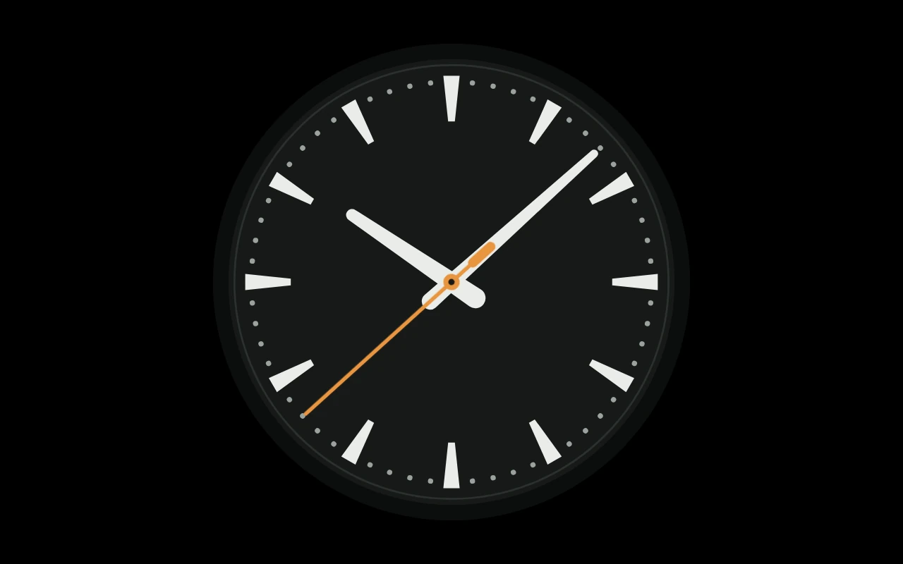
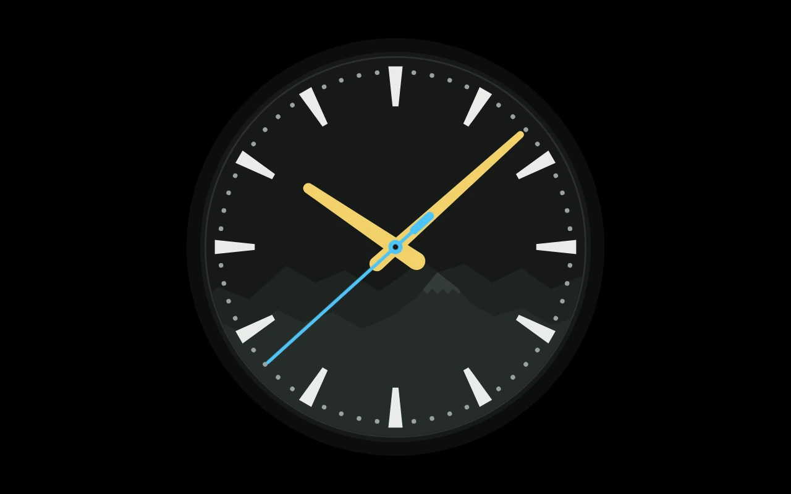
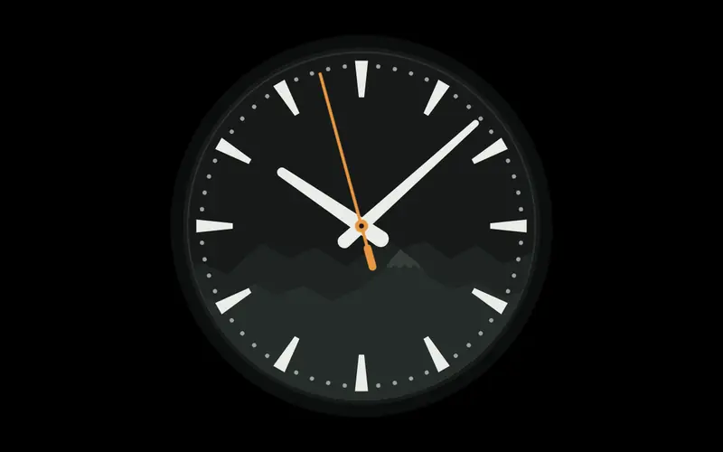
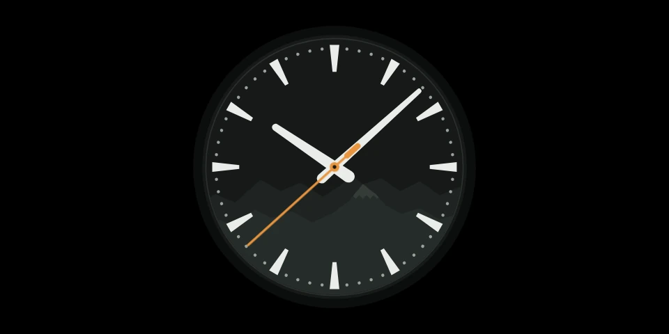

<p align="center"></p>

<p align="center"><a href="https://ko-fi.com/missingfoss"></a></p>

# Alpine Clock

A station-style clock screensaver for [Kiosk Satellite](https://github.com/jxlarrea/kiosk-satellite). The second hand sweeps the dial in 58.5 seconds and waits at twelve for the minute, the stop-to-go movement railway clocks have used since 1944; then the minute and hour hands step on together. An optional Alpine ridge runs across the lower half of the face.

<!-- screenshots:start -->
## Screenshots

<p align="center"><br><sub>Every setting at its default</sub></p>

<table>
<tr><td width="50%" valign="top"><br><sub>Face: Day</sub></td><td width="50%" valign="top"><br><sub>Numbers: 12 · 3 · 6 · 9</sub></td></tr>
<tr><td width="50%" valign="top"><br><sub>Face: Day · Numbers: All hours</sub></td><td width="50%" valign="top"><br><sub>Mountains: off</sub></td></tr>
<tr><td width="50%" valign="top"><br><sub>Custom hand colours: on · Hour hand: #F2D16B · Minute hand: #F2D16B · Second hand: #4FC3F7</sub></td><td width="50%" valign="top"><br><sub>Every setting at its default</sub></td></tr>
<tr><td colspan="2" align="center"><br><sub>960 × 480 screen · Every setting at its default</sub></td></tr>
</table>

All at 10:08, with Slow drift off; every other setting at its default. Regenerate with `python3 tools/screenshots.py`.
<!-- screenshots:end -->

## Requirements

Android 7.0 or newer, on any device where Kiosk Satellite can show a screensaver. (An Echo Dot running Kiosk Satellite has no screen, so no screensaver.) Kiosk Satellite 2026.10.23 or newer.

## Settings

Under **Plugin Manager → Alpine Clock**:

- **Face**: Night (dark, the default) or Day (light). The screen around the clock stays black;
- **Mountains**: the Alpine ridge across the lower half of the face, on by default;
- **Numbers**: none (the default), 12 · 3 · 6 · 9, or all hours, in place of those hours' marks. The minute dots stay;
- **Custom hand colours**: off, the hands follow the face. On, choose the **Hour hand**, **Minute hand** and **Second hand** colours;
- **Size**: how much of the screen's shorter side the clock fills;
- **Slow drift**: moves the clock a little each minute, round a small circle once an hour.

Choose **Alpine Clock** under **Screensaver → Screensaver mode**. The clock follows the tablet's time and stores nothing. The face is drawn once; between minutes only the second hand moves, as a CSS animation. The numbers use the system font, so no font is shipped.

## Installation

### Community Plugins (Recommended)

Alpine Clock is listed in [Community Plugins](https://kiosksatellite.com/plugins/). Use the button below to open it in your Kiosk Satellite and install it.

[](https://kiosksatellite.com/redirect/plugin/?repository=missing-foss/alpine-clock)

Or search for `Alpine Clock` in **Settings > Plugin Manager > Browse plugins** in Kiosk Satellite.

### Manual

1. Open **Settings > Plugin Manager** in Kiosk Satellite and turn on **Enable Plugins**.
2. Choose **Add plugin**, paste `https://github.com/missing-foss/alpine-clock` and choose **Preview**.
3. Review the plugin and choose **Trust and install**.

### From a ZIP

For testing, build the ZIP (below) and use **Plugin Manager → Developer Tools → Install from ZIP**. Each CI run also keeps the package as its `alpine-clock-plugin` artifact; the downloaded file installs as it is, without unzipping.

## Data

Alpine Clock sends no data anywhere: it reads only its own files and makes no network request.

## Develop

You need Python 3, JDK 17 or newer, Node.js 18 or newer, and an Android SDK with a platform and build-tools (`ANDROID_HOME` set).

```sh
python3 tools/test.py                            # every test
python3 tools/build.py --android-platform 35     # dist/alpine-clock-<version>.zip
```

`tools/test.py` runs:

- the plugin against the SDK without a device;
- the movement (`assets/clock/movement.js`) and the face's geometry (`assets/clock/face.js`) in Node;
- the build tools' own tests.

`tools/screenshots.py` renders the Screenshots above from `assets/clock/` at a fixed time, and rewrites their captions from the settings each shot uses. It needs Chromium (or Chrome) and ffmpeg with libwebp; run it again when the face changes.

The screensaver is `assets/clock/`: an HTML page, with `movement.js` turning the time into the hands' angles and `face.js` drawing the face as SVG. The Java plugin only publishes the page with its settings.

The icon's source is `art/icon.svg`. Render it with `rsvg-convert -w 256 -h 256 art/icon.svg -o assets/icon.png`.

## Support

Alpine Clock is free. If it keeps good time on your wall and you'd like to support its development, you can on [Ko-fi](https://ko-fi.com/missingfoss).

## Licence

[Apache-2.0](LICENSE), as the plugin template and SDK it builds on.
